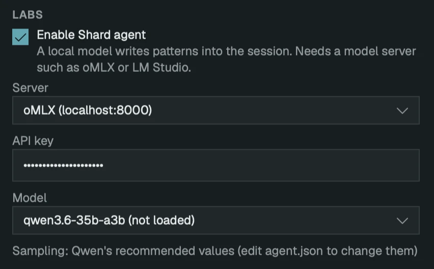

# Set up the agent

The agent runs on a model server on your Mac. Shard talks to oMLX or LM Studio, and the agent was tuned on Qwen3.6 35B A3B, which takes 20 GB of memory beside Shard and the server.

## To enable the agent

1. Choose **Shard ▸ Settings…** (⌘,).
2. Under **Labs**, tick **Enable Shard agent**, then choose the **Server**, paste the **API key** if it has one, and choose the **Model**.



## Servers

**oMLX** The one to use. It loads a model on the first request that names it, about a second per GB, and needs an API key.

**LM Studio** Answers only with a model you've loaded in it, and needs no key. Load the model and start its local server first.

**Other…** Any address that speaks the OpenAI chat API.

## To set up oMLX

1. Install oMLX from [github.com/jundot/omlx](https://github.com/jundot/omlx) and open **oMLX.app**.
2. Download the model into oMLX's models folder. The folder name becomes the model's name in Shard:

   ```
   hf download lmstudio-community/Qwen3.6-35B-A3B-MLX-4bit --local-dir ~/.omlx/models/qwen3.6-35b-a3b
   ```

3. Copy the API key from `auth.api_key` in `~/.omlx/settings.json` into Shard's **API key** field.

## Settings ▸ Labs

**Enable Shard agent** Off by default. When off, Shard sends no request to a model server and **View ▸ Agent** is unavailable. Unticking it stops a reply in progress.

**Server** Where the model runs.

**API key** Sent with every request.

**Model** The models the server offers, listed once it answers. **Whatever is loaded** uses the model the server has loaded.

## Messages

**"No model is loaded in oMLX at localhost:8000."** The model is set to **Whatever is loaded** and oMLX has nothing loaded. Choose a model by name.

**"oMLX at localhost:8000 has no model called …"** The model isn't in `~/.omlx/models`. Choose one from the list, or download it.

**"The server at localhost:8000 wants an API key."** Paste the key from `~/.omlx/settings.json` into **API key**.

**"No model loaded in LM Studio at localhost:1234."** Load a model in LM Studio.

**"… isn't loaded in LM Studio at localhost:1234."** LM Studio has a different model loaded. Load the one named, or choose the loaded one.

**"No model is set, and the server doesn't say which one is loaded."** The server doesn't list its models. Type the model's name into **Model**.

**An empty model list.** The server isn't running. Open oMLX.app, or start LM Studio's server.

**A reply that stops at a limit** (time, tokens, turns, or going in circles). What it wrote is kept. Ask again, or choose **Quick**.

## See also

- [Write tracks with the agent](agent.md)
