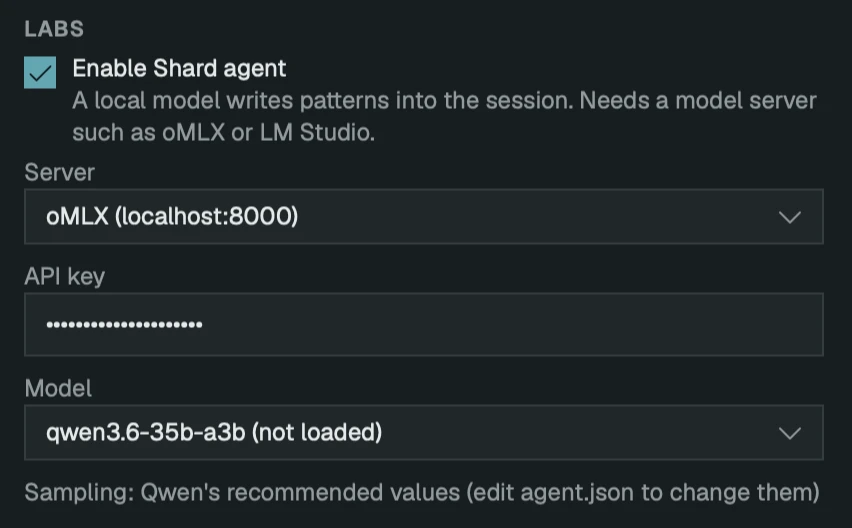
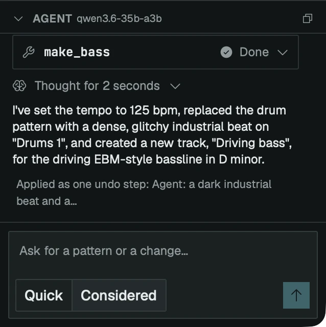

# The agent

The agent is a chat panel. You describe what you want, and a local model writes drum, bass, arpeggio and melody tracks into the open session, and sets the tempo.

It is off by default. While it is off, Shard talks to no server at all.

## Switch it on

Open **Settings** (Cmd-,) and find the **Labs** section. Tick **Enable Shard agent**. The server, API key and model fields appear below it.

Untick it and the panel closes, **View ▸ Agent** and **File ▸ Save Agent Session** grey out, and a reply in progress stops first.

## A model server

Shard doesn't bundle a model. It talks to a server on your Mac that speaks the OpenAI chat API: oMLX, which is the one to use, or LM Studio.

The agent was tuned on Qwen3.6 35B A3B, an MLX 4-bit build. The model is 20 GB on disk and in memory, so the Mac needs room for that beside Shard and the server. It was tried on a 64 GB M5 Pro.

### oMLX

1. Install oMLX from [github.com/jundot/omlx](https://github.com/jundot/omlx) and open **oMLX.app**. It starts a server at `localhost:8000`.
2. Find the API key in oMLX's settings. It is `auth.api_key` in `~/.omlx/settings.json`. oMLX refuses every request without it.
3. Download an MLX build of Qwen3.6 35B A3B into oMLX's models folder, one folder per model:

   ```
   hf download <repo> --local-dir ~/.omlx/models/<id>
   ```

   `<repo>` is the model's repository on Hugging Face, and `<id>` is the folder name, which becomes the model's name in Shard. The build Shard was tuned on is `lmstudio-community/Qwen3.6-35B-A3B-MLX-4bit`.

You don't load the model by hand. oMLX loads it on the first request that names it, which takes about a second per GB, and the panel says "Loading …" while it waits.

### LM Studio

Load the model in LM Studio first, and start its local server (`localhost:1234`). Shard asks only for a model that is already loaded.

## Set it up in Shard

In **Settings ▸ Labs**:



- **Server**: oMLX or LM Studio. **Other…** takes any address that speaks the same API.
- **API key**: paste the oMLX key. LM Studio needs none, so leave the field empty.
- **Model**: a list of what the server offers, once it answers. Leave it on the first entry, **Whatever is loaded**, to use whichever model the server has loaded. With oMLX, pick the model by name.

## Ask for something

Choose **View ▸ Agent** (Option-Cmd-A). The panel opens beside the tracker. Type a request and press Return:

> a dark industrial beat and a driving bass line in D minor, 125 bpm

Ask for what a track should be: a style, a key, a tempo, a feel. The reply streams into the panel, with the model's reasoning and each tool it calls, and the tracks appear in the session when it finishes.



**Quick** and **Considered**, under the prompt, set how long the model thinks. Quick answers in seconds. Considered reasons first, writes denser lines and takes about a minute or more.

Each request reads the song as it stands. The panel's earlier messages aren't sent back to the model, so "again, but faster" means nothing to it. Say what you want in full.

## Stop, undo, keep a record

- **Esc** in the panel stops a reply. Whatever it had written by then is kept, as one undo step.
- **Edit ▸ Undo** takes back everything one reply wrote.
- **File ▸ Save Agent Session** writes a folder with the session, the agent's log and the same log as JSON, and shows its path. Attach it to a bug report. The API key isn't in it. The command needs the agent to have been asked something first.
- The copy button in the panel's header copies the conversation, tool calls included.

## When it says

**"No model is loaded in oMLX at localhost:8000. Pick one in Settings, then ask again."** The Model field is on "Whatever is loaded" and oMLX has nothing loaded. Pick a model by name in Settings.

**"oMLX at localhost:8000 has no model called …"** The name in Settings isn't in oMLX's models folder. Pick one from the list, or download it into `~/.omlx/models/<id>`.

**"No model loaded in LM Studio at localhost:1234. Load one there, or pick another server in Settings."** LM Studio has no chat model loaded. Load one in LM Studio.

**"… isn't loaded in LM Studio at localhost:1234. Load it there, or pick another server in Settings."** The model named in Settings isn't the one LM Studio has loaded.

**"No model is set, and the server doesn't say which one is loaded. Name one in Settings, then ask again."** The server doesn't list its models. Type the model's name into the Model field.

**"The server at localhost:8000 wants an API key. Add it in Settings, then ask again."** Paste the key into **API key**. For oMLX it is `auth.api_key` in `~/.omlx/settings.json`.

If the model list is empty and a request fails to connect, the server isn't running. Open oMLX.app, or start LM Studio's server.

## Stopped by a limit

A reply that runs too long stops itself and says why: it took longer than the time limit, used up its tokens or its turns, or was going in circles. What it had written is kept. Ask again, or switch to Quick.
